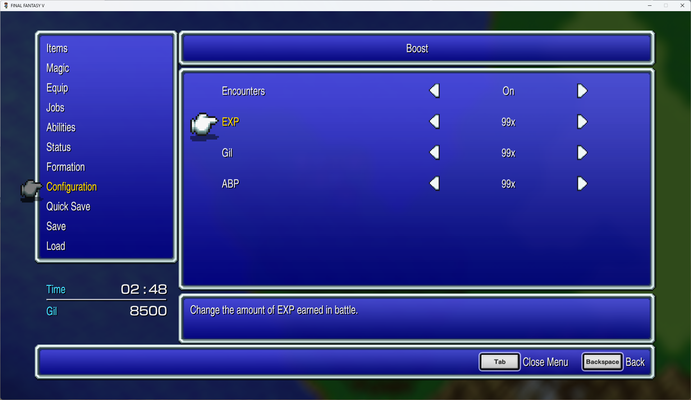

# FFV Boost Options

> **AI disclosure:** This mod — source code, documentation and debugging — was produced with the help
> of an AI assistant (GitHub Copilot in VS Code). It has been tested in-game, but it comes with no
> warranty: review the source and back up your saves before relying on it.

A BepInEx plugin for **FINAL FANTASY V Pixel Remaster** that widens the multipliers offered by the
in-game Boost menu.

Vanilla offers `0x`, `0.5x`, `1x`, `2x`, `4x`. With this mod every boost row becomes:

```
0x, 0.5x, 1x, 2x, 3x, 4x, 5x, ... up to MaxMultiplier
```



It applies to the EXP, Gil, ABP and the other rate-based boost rows the game hides behind
`ConfigCommandType.*Rate`. Booleans (encounters, HP growth) are untouched.

## Requirements

* FINAL FANTASY V Pixel Remaster (Steam)
* BepInEx 6 (IL2CPP, `6.0.0-be.697` at the time of writing) set up per
  [the usual Pixel Remaster modding guide](https://steamcommunity.com/sharedfiles/filedetails/?id=2788533275)
  - Magicite is not required by this mod
  - On a Steam Deck or other Linux/Proton setup, see
    [Steam Deck](#steam-deck-and-other-linuxproton-setups) below — BepInEx needs one extra step
    there
* The interop assemblies BepInEx generates on first launch (`BepInEx/interop`)

## Build and install

```powershell
dotnet build -c Release -p:DeployToPlugins=true
```

That copies `FFVBoostOptions.dll` into `BepInEx/plugins`. Without `-p:DeployToPlugins=true` the
build output lands in `bin/Release/net6.0/` and can be copied manually.

If your game is not at the default Steam path, override it:

```powershell
dotnet build -c Release -p:GameDir="D:\Games\FINAL FANTASY V PR" -p:DeployToPlugins=true
```

The project references the interop assemblies from `$(GameDir)\BepInEx\interop`, so BepInEx must
have run at least once before the plugin can be compiled.

## Steam Deck (and other Linux/Proton setups)

The Steam build is Windows-only, so on a Steam Deck the game runs through Proton. BepInEx will not
start unless Proton is told to load the game's own `winhttp.dll`, which is Doorstop's injection
point. Without that override the game runs normally but BepInEx never initialises: no
`BepInEx/config`, no `BepInEx/interop`, no `LogOutput.log` — the `BepInEx` folder just keeps the
stock `core`, `patchers` and `plugins` directories.

1. Install the **Windows x64** BepInEx 6 IL2CPP pack into
   `.../steamapps/common/FINAL FANTASY V PR`, copying the whole archive. `winhttp.dll`,
   `doorstop_config.ini`, `.doorstop_version` and the `dotnet` folder belong next to the game
   executable, alongside `BepInEx/`; copying only the `BepInEx` folder is not enough.
   * `.doorstop_version` starts with a dot, so Dolphin hides it unless hidden files are enabled.
   * The folder must be named `BepInEx` exactly — ext4 on the SD card is case-sensitive.
2. In Steam, open FINAL FANTASY V → **Properties → General → Launch Options** and enter:

   ```
   WINEDLLOVERRIDES="winhttp=n,b" %command%
   ```

   This is the step that makes BepInEx load under Proton. If you'd rather not use launch options,
   the equivalent one-off setup is protontricks → the game → `Select the default wineprefix` →
   `Run winecfg` → **Libraries** → add `winhttp` → Apply.
3. Launch the game **from Steam** and leave it at the title screen while BepInEx generates
   `BepInEx/interop`; the first launch is slow. `BepInEx/LogOutput.log` should appear afterwards.
4. Copy `FFVBoostOptions.dll` into `BepInEx/plugins` and confirm the log contains
   `FFV Boost Options ... loaded`.

Build against the same BepInEx build that is installed on the Deck; if the Deck has a different
BepInEx 6 build, rebuild with that version so the interop assemblies match.

## Configuration

`BepInEx/config/com.lukahn.ff5.boostoptions.cfg`

The file is generated automatically the first time the plugin loads; there is nothing to create or
copy before installing. Edit it (or use a config manager) to change the values below.

| Section | Key | Default | Meaning |
| --- | --- | --- | --- |
| `Options` | `MaxMultiplier` | `99` | Highest multiplier shown in the menu |
| `Debug` | `VerboseLogging` | `false` | Logs row building and index/multiplier conversions |

Changing `MaxMultiplier` takes effect the next time the Boost screen is opened.

## How it works

The game keeps the boost multiplier as a plain `float` in `Last.Data.CheatSettingsData` and applies
it inside `Last.Management.CheatSettingsClient.GetResultAbp` (and its siblings). Only the menu is
restrictive, so the mod works on the menu layer:

* `ConvertIndexIntoRateValue` / `ConvertRateValueIntoIndex` are replaced with a table that maps
  index → multiplier and back (`0, 0.5, 1, 2, 3, 4, ...`).
* `SetCommandNameList` (in `Serial.FF5.UI.KeyInput/Touch.ConfigActualDetailsController`) rebuilds the
  row's option labels, keeping the game's localised text for the first four entries.
* `Set*Rate(int index)` is driven straight into `CheatSettingsClient`, because the game's own helpers
  read past the end of a private five-entry table for custom indices and would store `0`.

All patches are applied to the native IL2CPP methods through BepInEx's Harmony detours, so no game
files are modified.

## Notes and limitations

* The one-line description under the list still shows the vanilla text for the `4x` entry when a
  custom value is selected. It does not affect the actual multiplier.
* Saves store the raw multiplier, so a save made with e.g. `12x` will still say `12x` if you later
  uninstall the mod. The game will keep applying it and the Boost menu will show the closest vanilla
  option, so set the value back before removing the mod if you want a clean save.
* Only the multiplier `float` is touched. Nothing is written outside the save data.

## Uninstall

Delete `BepInEx/plugins/FFVBoostOptions.dll` (and optionally the config file above).
